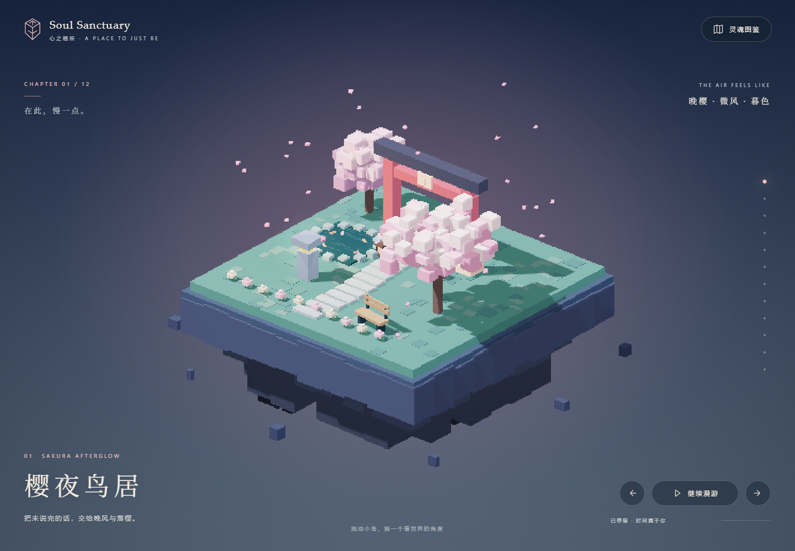
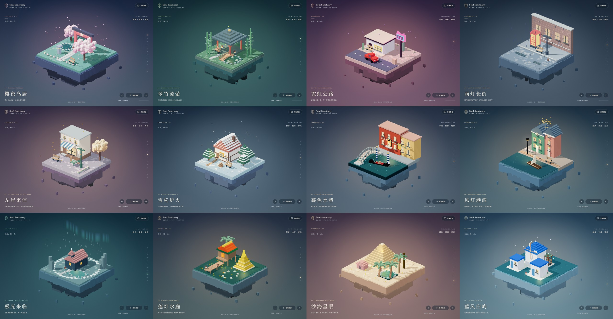
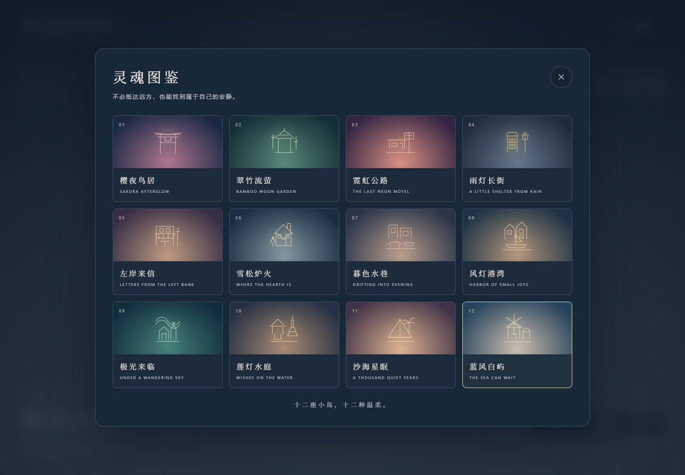

# 🌌 Soul Sanctuary | Global Pixel Pilgrimage

[](https://CNSleepybear.github.io/soul-sanctuary/)
[](https://threejs.org/)
[](https://en.wikipedia.org/wiki/Voxel)
[](LICENSE)

An interactive **WebGL voxel art installation** built with **Three.js**, featuring **12 procedurally generated emotional havens** with cultural influences from around the world. Each station is a self-contained floating diorama with detailed architecture, gardens, atmospheric particles, and living light — all rendered in crisp low-resolution pixel art style.

> *"Stop the mental churn. Let the cherry blossoms fall. Let the aurora dance. Let the snow bury the deadlines."*

---







### Art Refresh
- **A softer world**: destination-specific dusk gradients, a restrained star field, warm/cool light separation, sRGB color calibration, ACES tone mapping, and soft shadows.
- **Islands with depth**: tiered, chamfered voxel rock masses, irregular hanging stone, and gently floating satellite rocks.
- **Places to linger**: blossoming trees, garden bridges, koi, lotus ponds, café windows and flowers, snow-capped roofs, a stepped pyramid and palm oasis.
- **Living water and sky**: teal water, breathing ripples, hot-spring steam, and an animated translucent aurora ribbon.
- **A quiet interface**: poetic bilingual haven names, a collapsible 12-destination atlas with original line-art emblems, minimal travel controls, and responsive layouts.
- **Thoughtful motion**: slower 20-second journeys, working mouse/touch orbit, keyboard navigation, and reduced-motion support.

See [Art Direction](ART_DIRECTION.md) for the visual reference principles and per-destination details. Everything remains procedurally drawn; no third-party game models, textures, screenshots, or logos are used.

## ✨ Features

### 🌍 12 Global Spiritual Retreats
Travel through **12 handcrafted voxel destinations**, each capturing an atmosphere rather than a tourism checklist:

| Station | Country | Landmark | Particle System | Mood |
|:---|:---|:---|:---|:---|
| 🌸 樱夜鸟居 / Sakura Afterglow | Japan | Torii, layered sakura, koi pond & bench | Falling Petals | Tender, ephemeral |
| 🎋 翠竹流萤 / Bamboo Moon Garden | China | Pavilion, bamboo, curved garden bridge & lotus | Floating Fireflies | Meditative, ancient |
| 🌵 霓虹公路 / The Last Neon Motel | USA | Neon motel, road markings & pickup truck | Desert Dust | Retro, restful |
| ☎️ 雨灯长街 / A Little Shelter from Rain | UK | Phone booth, masonry, windows & rain puddles | Rain | Melancholic, cozy |
| 🍷 左岸来信 / Letters from the Left Bank | France | Café, striped awning, flower boxes & coffee | Autumn Leaves | Romantic, wistful |
| 🏔️ 雪松炉火 / Where the Hearth Is | Germany | Snow-capped timber house, pines & stacked firewood | Snow | Sheltered, warm |
| 🛶 暮色水巷 / Drifting into Evening | Italy | Gondola, arched stepped bridge & canal façades | Water Sparkles | Unhurried, intimate |
| 🔥 风灯港湾 / Harbor of Small Joys | Denmark | Colorful townhouses, quay & stepped sail | Chimney Embers | Hygge, intimate |
| 🌌 极光来临 / Under a Wandering Sky | Iceland | Dark church, basalt, aurora ribbon & hot spring | Aurora & Steam | Solitary, sublime |
| 🪷 莲灯水庭 / Wishes on the Water | Thailand | Stilt house, golden chedi, timber pier & lotus | Floating Lanterns | Spiritual, flowing |
| 🔺 沙海星眠 / A Thousand Quiet Years | Egypt | Ten-tier pyramid, palms, oasis & small shelter | Sand Drift | Timeless, restful |
| 🌀 蓝风白屿 / The Sea Can Wait | Greece | Centered windmill, white terraces & vine pergola | Sea Breeze | Bright, liberating |

### 🎮 Interactive Controls
- **Auto-Cruise Mode**: Automatically transitions between stations every 20 seconds
- **Manual Navigation**: Arrow buttons, keyboard arrows, or destination dots
- **Cruise Toggle**: `停留此刻` pauses the journey; `继续漫游` resumes it
- **Mouse / Touch Drag**: Grab and rotate the diorama to inspect details
- **Soul Atlas**: Open `灵魂图鉴` to select any haven; camera motion and cruise progress pause while it is open
- **Reduced Motion**: Respects the system preference by disabling auto-cruise and environmental animation by default

### 🌧️ Dynamic Climate Matrix
Each station runs a **unique particle physics simulation**:
- **Falling** (Japan/France): Gravity-driven petals and leaves with sinusoidal drift
- **Firefly** (China): Orbital bioluminescence with pulsing scale and life-like flicker
- **Dust Storm** (USA): Horizontal wind shear with turbulent oscillation
- **Rain** (UK): High-velocity vertical drops with mist refraction lighting
- **Snow** (Germany): Damped descent with micro-drift, matching Germanic precision
- **Rise** (Italy): Buoyant water sparkles with gentle harmonic bobbing
- **Smoke** (Denmark): Chimney embers with lifecycle aging, sway dispersion, and height death
- **Aurora** (Iceland): Lateral solar-wind flow with Z-axis curtain wave physics
- **River Drift** (Thailand): Krathong lanterns with downstream current and wave-rocking
- **Float** (Greece): Weightless Aegean particles with wide orbital wandering

### 💡 Living Light Systems
- **Flickering Lanterns**: Candle/oil-lamp simulation using layered sine waves + random noise
- **Neon Breathing** (USA): A subtle, periodic dip rather than rapid random flashes
- **Aurora Directional**: Green-tinted rim light casting across the black sand from celestial curtains
- **Hearth Breathing** (Denmark): Multi-frequency intensity modulation mimicking fireplace ember pulse

---

## 🚀 Live Experience

**🔗 [Launch Soul Sanctuary](https://CNSleepybear.github.io/soul-sanctuary/)**

### 🕹️ Controls

Zero learning curve — mouse, touch, or keyboard:

| Button | Function | Detail |
|:---|:---|:---|
| **← / → buttons** | Previous / Next | Gentle scene reveal; wraps around all 12 havens |
| **停留此刻 / 继续漫游** | Toggle Auto-Pilot | Pause/resume the 20-second auto-transition |
| **灵魂图鉴** | Destination Atlas | Choose any haven; Escape closes the dialog |
| **Drag Canvas** | Manual Orbit | Mouse or touch drag rotates the diorama |
| **Keyboard ← / →** | Previous / Next | Available when no button or dialog has focus |
| **Space / M** | Cruise / Atlas | Available when no button or dialog has focus |

### 💡 Viewing Tips
1. **Let it cruise** first — the auto-transition is timed for meditative pacing
2. **Pause on your favorite** — hit `停留此刻` to absorb the atmosphere
3. **Drag to inspect** — the voxel construction rewards close inspection (German timber framing, Thai chofa roofs, etc.)
4. **Full-screen recommended** — the pixel-stretch effect is most immersive at maximum viewport

---

## 🛠️ Tech Stack

- **Three.js r128**: WebGL rendering, instanced voxel details, PCF soft shadow mapping
- **Orthographic Camera**: Classic isometric diorama perspective (no perspective distortion)
- **Low-Resolution Pipeline**: 480px internal height on desktop, 680px on portrait screens; width matches viewport aspect, with CSS `image-rendering: pixelated`
- **Procedural Materials**: Flat-shaded Lambert voxels, Phong water, a generated glow texture, and a custom aurora ribbon shader — zero external art assets
- **Color and Light**: Linearized material colors, sRGB output, ACES tone mapping, hemisphere fill and a warm key light
- **Particle Physics Engine**: Per-station custom update loops (gravity, wind, buoyancy, lifecycle)
- **Dynamic Lighting**: `AmbientLight` + `PointLight` + `DirectionalLight` with real-time intensity modulation
- **Single-File Architecture**: Entire experience contained in one `index.html` — no build step, no dependencies beyond Three.js CDN

---

## 📦 Local Setup

### Requirements
- Modern browser with WebGL support (Chrome 90+ / Firefox 88+ / Edge 90+ / Safari 14+)
- Any local HTTP server, plus network access to the Three.js CDN

### Quick Start

```bash
# Clone the repository
git clone https://github.com/CNSleepybear/soul-sanctuary.git
cd soul-sanctuary

# Serve locally
python -m http.server 8000
# or
npx http-server -p 8000

# Open in browser
open http://localhost:8000
```

> **Note**: The classic script-tag version can also run from `file://` when CDN access is available. A local server is recommended for predictable browser behavior.

---

## 📁 Project Structure

```
soul-sanctuary/
├── index.html          # Complete self-contained application (CSS + JS + HTML)
├── README.md           # This file
├── ART_DIRECTION.md    # Visual direction, reference principles and validation
├── LICENSE             # MIT License
└── screenshots/        # Refreshed desktop, atlas and mobile previews
```

> **Architecture**: Single-File Application. All 12 station builders, particle systems, lighting rigs, and UI controls are inlined. Deploy by copying one file to any static host.

---

## 🎨 Technical Deep Dive

### 1. Voxel Construction Engine
Every landmark is built from `THREE.BoxGeometry` primitives composed into hierarchical `Group` objects:

```javascript
// Japanese Torii Gate example
const postL = createBox(0.5, 4, 0.5, materials.torii, -2, 2, 0, true);
const tie = createBox(4.6, 0.4, 0.4, materials.torii, 0, 3.2, 0, true);
const topBar = createBox(5.4, 0.5, 0.6, materials.toriiTop, 0, 4.0, 0, true);
torii.add(postL, postR, tie, topBar);
```

**Notable architectural details:**
- **Germany**: X-brace timber framing (Fachwerkhaus), stepped gable roof layers, snow-cap chimney
- **Thailand**: 6-pillar stilt foundation, multi-tiered Chofa roof with golden finial, 8-layer Chedi stupa
- **Iceland**: Basalt column matrix with height-varied stacks, Reynisdrangar sea-stack replicas, steeple with voxel cross
- **USA**: Classic pickup truck (chassis/hood/cab/bed/4 wheels), neon sign with V-wing tail fins

### 2. Hard-Pixel Render Pipeline
```javascript
const internalHeight = aspect < .8 ? 680 : 480;
renderer.setSize(Math.round(internalHeight * aspect), internalHeight, false);
// CSS scales to fullscreen with zero interpolation:
// image-rendering: pixelated;
```
This creates the signature **crisp voxel edge** aesthetic without a full-screen post-processing chain and without stretching the scene's aspect ratio.

### 3. Particle Physics Taxonomy
Each station registers its particles with a typed behavior tag:

| Type | Forces | Reset Condition |
|:---|:---|:---|
| `fall` | `-y gravity`, `±x sine drift` | `y < ground` |
| `firefly` | `orbital xz`, `±y bob`, `scale pulse` | `out of bounds` |
| `dust` | `-x wind`, `y oscillation` | `x < -6` |
| `rain` | `-y high velocity` | `y < 0.2` |
| `fall_spin` | `-y gravity`, `xz sway`, `xyz rotation` | `y < 0.15` |
| `snow` | `-y damped`, `±x micro-drift` | `y < 0.15` |
| `rise` | `+y buoyancy`, `±x sine` | `y > maxHeight` |
| `smoke` | `+y ascent`, `xz dispersion`, `age decay` | `age > maxLife` |
| `aurora` | `+x flow`, `z curtain wave`, `y ripple` | `x > 6` |
| `krathong` | `+z current`, `±x wave-rock`, `y bob` | `z > 5` |
| `drift` | `+z sand flow`, `y abs-sine` | `z > 5` |
| `float` | `+y levitation`, `wide xz orbit` | `y > 6` |

### 4. Motion and Resource Lifetime
Particle movement uses frame delta rather than a fixed 60fps assumption. Shared detail batches use `InstancedMesh` for foliage, masonry, rock tiers and ripples. Scene changes dispose the complete geometry/material hierarchy and old shadow maps; the star field and generated glow texture remain shared.

### 5. Light Flicker Algorithms
```javascript
// Standard candle: layered sine + noise
intensity = base + sin(elapsed * speed) * amp + cos(elapsed * speed * 1.5) * (amp * 0.5);

// Neon breathing: occasional dimming without rapid flashes
if (!reducedMotion.matches && Math.sin(elapsed * 1.6) > .99) {
    intensity *= .7;
}
```

---

## 📝 Development Notes

### Art Refresh
- ✅ All 12 destinations receive new details and calibrated palettes
- ✅ Tiered floating rock islands, natural foliage, garden and canal bridges
- ✅ Hot-spring steam, koi, ripples and a custom aurora ribbon
- ✅ Original SVG atlas emblems and bilingual poetic haven identities
- ✅ Responsive portrait, landscape and widescreen compositions
- ✅ Functional pointer/touch orbit, keyboard navigation and accessible atlas dialog
- ✅ Reduced-motion preference and complete scene resource disposal

### v1.0 Foundation
- ✅ 12 fully realized voxel dioramas with culturally specific architecture
- ✅ 12 independent particle physics systems
- ✅ Auto-cruise with manual override
- ✅ Responsive orthographic camera with window resize adaptation
- ✅ Dynamic lighting with per-station color palettes and flicker behaviors
- ✅ Zero external assets — pure procedural generation

### Roadmap
- 🔄 **Ambient Audio**: Procedural generative music per station (synth pads, rain noise, wind howl)
- 🔄 **Day/Night Cycle**: Smooth time-of-day transitions within each station
- 🔄 **Interactive Elements**: Clickable lanterns to toggle lights, clickable doors to "enter" buildings
- 🔄 **Additional Mobile Gestures**: Pinch to zoom orthographic scale
- 🔄 **VR Mode**: Stereo rendering for WebXR-compatible headsets
- 🔄 **Seasonal Variants**: Winter/Summer versions of each station (snow vs. green foliage)

---

## 🤝 Contributing

Pull requests and issues welcome! Priority directions:
- 🎭 New station proposals (Korea, Morocco, Peru, etc.)
- 🧩 Additional particle behaviors (butterflies, ash fall, cherry blossom blizzards)
- 🌐 Multi-language UI support
- 📱 Touch/gesture optimization
- 🎨 Post-processing experiments (bloom, chromatic aberration) as toggleable options

---

## 📄 License

**MIT License** — see [LICENSE](LICENSE) for details.

> All voxel designs and atmospheric concepts are original. Cultural landmarks are stylized abstractions, not exact replicas.

---

## 🙏 Acknowledgments

- **Three.js**: The indispensable WebGL abstraction layer
- **r/pixelart & r/voxelart**: Communities that keep the low-res aesthetic alive
- **Lo-Fi Girl / ChilledCow**: Sonic inspiration for the meditative pacing
- **Tourist Eye**: The real-world beauty that made these 12 stations worth building

---

⭐ **If Soul Sanctuary gave you 30 seconds of peace, consider starring the repo. The world needs more quiet corners.**

*To all the late-night debug sessions, the unread notifications, and the deadlines that can wait until tomorrow — this sanctuary is for you.*
